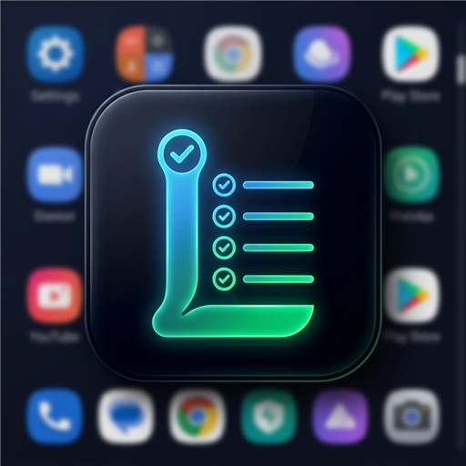

  

# ListGen

**A high-performance, native Android list manager with detailed outcome tracking.**

ListGen is designed for speed, precision, and aesthetic clarity. Built natively in Kotlin with **Jetpack Compose (Material 3)**, it pairs a sleek neon dark-mode interface with smooth 120Hz drag-and-drop organization and rich task outcome tracking.

## ✨ Features

- **📊 Grid & Compact List Views:** Switch seamlessly between 2-column preview cards and a compact row layout, with smooth long-press drag-and-drop reordering and edge auto-scrolling.
- **✅ Detailed Outcomes (Done / Failed):** Long-press to mark tasks as **Done** (neon green) or **Failed** (neon magenta), or long-press again to reset.
- **📝 Contextual Notes & Reasons:** Optionally expand **Success Notes** or **Failure Reasons** per list to capture context right beneath any completed or failed item.
- **🎨 Per-List Customization:** Full-spectrum neon HSV hue picker, optional completion progress bars (`Fail = Progress` or `Success Only` modes), **Zen Mode** for ultra-dense focus, **Lock** protection, and **Disco Rave Mode** animated shaders.
- **🧹 Batch Management & Undo:** Multi-select lists to batch-lock or delete, with instant one-tap **Undo** recovery.
- **⚡ High-Performance Offline Vault:** Draw-phase GPU animations (zero idle frame wakeups) and debounced background DataStore persistence.

## 📱 Specifications

- **Package ID:** `com.tailgunnerx.listgen`
- **Version:** `1.0`
- **License:** [Apache License 2.0](LICENSE)
- **OS:** Android 7.0+ (API 24+)

## 🔒 Privacy & Transparency

- **Zero Tracking:** No Firebase, no analytics, no crashlytics.
- **100% Offline:** Works completely offline on-device. No internet permission is requested.
- **No Ads:** Clean, uninterrupted experience.

## 🛠️ Tech Stack

- **Language:** Kotlin
- **UI Framework:** Jetpack Compose (Material 3)
- **Persistence:** Jetpack DataStore Preferences + Gson

## 🚀 Getting Started

1. **Clone the Repo:** `git clone https://github.com/tailgunnerx/ListGen.git`
2. **Open in Android Studio:** Select the root project folder.
3. **Build & Run:** Deploy to your physical Android device or emulator (`./gradlew assembleDebug` or `./gradlew assembleRelease`).

---
*Created with focus on Rich Aesthetics and High Performance.*
